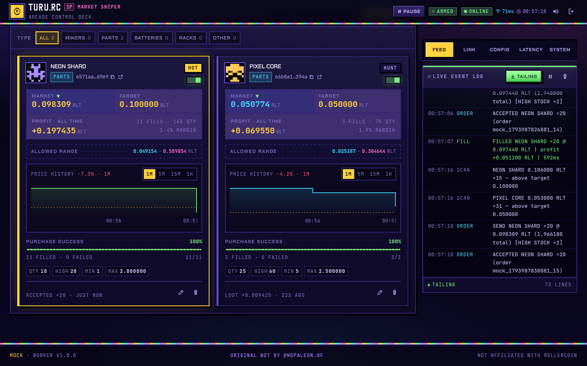

# TURU.RC // MARKET SNIPER

A headless Rollercoin marketplace sniper with an arcade-style control deck built with React 19 and Tailwind CSS v4. The worker runs as a separate Rust process. The browser serves only as the data plane for signing in, managing targets, monitoring the market, and reviewing order results.


| Login | Mobile |
| --- | --- |
|  |  |

| Target fleet | Profit report |
| --- | --- |
|  |  |

## Features

- **Headless worker.** Connects to `nws.rollercoin.com` over WebSocket, listens to every market frame, matches events against your targets, and sends `purchase-item` requests over HTTPS.
- **Access-key control plane.** The worker exposes HTTP and WebSocket endpoints protected by a bearer key. The key is generated once on first boot or pinned through `WORKER_TOKEN`.
- **Dynamic targets.** Add, edit, delete, arm, and disarm targets from the UI without restarting, then filter the fleet by arm state (active/inactive), item type, or label. Labels and rarity colors are resolved automatically from `item-info`.
- **Charts and success rate.** Every chart is a line chart. A price card shows a fixed 1D view in 30-minute buckets; click it to open a full-size view with 1–7 day ranges, 1m–1d buckets, a price axis, crosshair readout, and a target line.
- **Market activity chart.** Every market frame is counted into 5-minute buckets kept for a week, so the deck can chart how busy the feed was over 1, 3, or 7 days at 5m, 15m, 30m, 1h, or 2h buckets, aligned to your local clock.
- **Session manager.** Access and refresh tokens are stored in SQLite. The access token is refreshed before expiry, and requests are retried once after a 401 response.
- **Token bridge.** A Tampermonkey userscript or console snippet keeps Rollercoin tokens in sync every 30 seconds.
- **Safety rails.** Includes a global cooldown between orders, an orders-per-minute cap, backoff after rejected purchases, three explicit trading modes (off, shadow, live), strict validation, and a STOP/START control in the header.
- **Persistent loot log.** Every fill and failure is stored in SQLite, with server-side search and cursor-based paging.
- **Profit report.** Shows per-product totals for fills, quantity, spend, average buy price, profit, margin, and success rate, with CSV export.
- **Backup and migration.** Export a portable JSON file or a database copy, then restore it on another worker.
- **Health monitor.** Tracks worker and host CPU, RAM, swap, load average, sampler lag, database and WAL size, and SQLite query metrics.
- **Mock mode.** Provides a built-in market simulator for testing the full flow without a Rollercoin account.
- **Test suite.** Covers backend unit, HTTP, and end-to-end tests, plus UI tests.

## Installation

Requirements:

- Rust 1.99.1 (pinned in `mise.toml`) or a recent Rust toolchain
- Bun 1.2 or newer
- Node.js for the Vite development server
- `libssl3` on Debian and Ubuntu

Steps:

```bash
git clone https://github.com/n0paleon/rc-autotrade.git
cd rc-autotrade
mise install
bun install
cp .env.example .env
bun start
```

`bun start` builds the UI into `dist/` and then runs the release worker. If mise is not active in your shell, run `mise exec -- bun start` so the pinned toolchain is used. Build on the same machine that will run the binary because it links against glibc and `libssl`.

On first boot, the worker prints an access key once. Open `http://127.0.0.1:8787`, paste the key, and press **PRESS START**.

To try the app without a Rollercoin account:

```bash
bun run mock
```

For production with PM2:

```bash
bun install -g pm2
bun run build
cargo build --release
pm2 start ecosystem.config.cjs
pm2 save
pm2 startup
```

`pm2 startup` prints a sudo command. Run that command, then run `pm2 save` once more. Use a single instance. The worker maintains a single market WebSocket connection and a single order state, so multiple instances can submit duplicate orders.

Key environment variables:

| Variable | Default | Description |
| --- | --- | --- |
| `HOST` | `127.0.0.1` | Bind address for the control plane |
| `PORT` | `8787` | Port for the control plane |
| `WORKER_TOKEN` | empty | Pins the access key. Minimum 16 characters |
| `DATA_DIR` | `./data` | Location of `rollercoin.db` |
| `RC_COOKIE` | empty | Cloudflare cookie copied from the browser |
| `MOCK` | `0` | `1` enables the simulator |
| `LOG_LEVEL` | `info` | `debug`, `info`, `warn`, or `error` |

You can reset the access key while the worker is stopped:

```bash
bun run key:reset
```

The default bind address is loopback only. If you need remote access, put the worker behind an HTTPS reverse proxy and never expose the raw port to the internet.

## Update

```bash
git pull
bun install --frozen-lockfile
bun run build
cargo build --release
pm2 restart rc-autotrade --update-env
```

Without PM2, stop the worker and start it again with `bun start`.

Changes to the UI require only `bun run build` because `dist/` is read per request. Rust changes need a rebuild and a restart. SQLite schema migrations run automatically on boot.

## Order execution

Every matching market frame produces one decision for its target. The engine evaluates only the **cheapest listing** priced in `RLT` and passes its unit price and stock to `plan_order()` in `src/rules.rs`. That function returns either a `buy` plan with a quantity or a `skip` plan with a reason. Runtime gates in `src/engine.rs` then decide whether the buy may be submitted.

The engine never averages listings, combines multiple listings, or cancels an order. Every quantity decision comes from the cheapest listing in the current frame.

TREND WATCH is informational only. It never submits orders, and `plan_order()` remains the only buy gate.

### Frame evaluation flow

1. Find the target by `itemId`. Matching is case-insensitive.
2. Ignore the frame when the currency is present and not `RLT`, or when the frame has no listings.
3. Listings are sorted by price ascending. If two listings share a price, the larger quantity comes first. The first listing is treated as the cheapest.
4. Call `plan_order()` with the cheapest unit price, its available stock, and the target settings.
5. If the plan is `skip`, record the reason and stop. The market feed and charts still update.
6. If the plan is `buy`, apply the runtime gates described below.
7. Submit `purchase-item` with the planned quantity and record the request timings.
8. When `marketplace_orders_filled` arrives, update the book, statistics, loot log, and profit report.

Example target:

```json
[
  {
    "itemId": "6571aa39ca8bfef34adcd9e9",
    "targetPrice": 0.1,
    "desiredQty": 10,
    "highStockThreshold": 20,
    "minAcceptableQty": 1
  }
]
```

### Quick reference

| Field | Affects planning | Role |
| --- | --- | --- |
| `itemId` | Yes | Matches market frames to this target |
| `label` | No | Display and search text |
| `itemType` | No | Item lookup and purchase payload |
| `rarityColor` | No | Card accent color |
| `targetPrice` | Yes | Per-unit price ceiling |
| `desiredQty` | Yes | Base quantity per order |
| `highStockThreshold` | Yes | Doubles the base quantity |
| `minAcceptableQty` | Yes | Minimum stock for a partial buy |
| `allowPartialOrder` | Yes | Enables or disables partial buys |
| `active` | Yes | Arms or disarms the target |

### Decision order

`plan_order()` applies these checks in order and stops at the first match:

1. Trading mode is `off`: skip `paused`.
2. Target is inactive: skip `inactive`.
3. Price is not finite or is at most 0: skip `invalid-price`.
4. Stock is not finite or is below 1: skip `no-stock`.
5. Cheapest price is above `targetPrice` by more than `1e-9`: skip `price-above-target`.
6. Stock is at least `desiredQty`: use `desiredQty`, or `2 x desiredQty` when stock is also at least `highStockThreshold`.
7. Stock is below `desiredQty`: take all stock if partial is enabled and stock is at least `minAcceptableQty`, otherwise skip `stock-below-minimum`.
8. Clamp the quantity between 1 and `min(stock, 10000)` and compute `notional = unitPrice x qty`.

### Target parameters

#### `itemId`

Required. The item to hunt. It accepts a raw ID of 6 to 64 characters from `A-Za-z0-9_-`, or a full marketplace URL. A URL is reduced to its last non-empty path segment.

- Matching against market frames is case-insensitive.
- Each ID may appear only once in the target list. Editing the existing row is allowed.
- An ID that never appears in a market frame produces no orders.

#### `label`

Optional and normally automatic. The worker fills it from `item-info` as `${rarityGroup.title.en} ${name.en}`. If `rarityGroup` is missing, it falls back to `name.en`, then to `ITEM <short-id>`. The maximum length is 48 characters.

- The label is used for display, the loot log, and server-side search.
- It never affects matching, planning, or order submission.

#### `itemType`

Optional. Defaults to `mutation_component`. The value is used when resolving `item-info` and when submitting `purchase-item`.

- The resolver tries `mutation_component`, `miner`, `rack`, and `battery` until the item is found.
- When a market frame carries an `itemType`, the worker stores the corrected type on the target. The stored type is used for later purchase requests.
- The resolved type does not change the buy decision.

#### `rarityColor`

Optional and normally automatic. A six-digit hex color taken from `rarityGroup.baseHexColor`.

- It is used only for the card accent.
- It has no effect on matching, planning, or orders.

#### `targetPrice`

Required. The maximum price per unit, not per order. It must be greater than 0, at most 1,000,000 RLT, and at most 6 decimal places.

- The engine compares `unitPrice` with `targetPrice + 1e-9`. A listing exactly at the target passes.
- Only the cheapest listing is checked. A deeper listing below the ceiling cannot rescue a frame whose cheapest listing is above it.
- When the cheapest listing is above the ceiling, the frame is skipped with `price-above-target` even if stock is plentiful.
- When the listing is below the ceiling, the engine pays the listing price, not `targetPrice`.
- The total for one order is `unitPrice x qty`. It can reach `2 x desiredQty` units when high-stock mode is active.
- `targetPrice` is not a budget or a balance check. The worker does not verify the RLT balance before sending an order.
- Profit is recorded as `(targetPrice - buyPrice) x qty`.
- The `allowedPriceMin` and `allowedPriceMax` band from Rollercoin is shown on the card but never used as a buy condition.

#### `desiredQty`

Required. The base quantity per order, from 1 to 10,000.

- When available stock is at least `desiredQty`, the order requests `desiredQty` units, or `2 x desiredQty` when high stock triggers.
- When available stock is below `desiredQty`, this value does not trim the order. The partial branch uses all available stock if partial orders are enabled.
- It is not a daily target, a total purchase limit, or a balance limit. Every passing frame can start a new order, subject to the runtime gates.
- The final quantity is always clamped to 10,000.

#### `highStockThreshold`

Required. An integer from `desiredQty` to 1,000,000. It is the stock level that enables quantity doubling.

- If available stock is at least `highStockThreshold`, the order requests `2 x desiredQty`. The trigger is not `2 x threshold` and not `2 x stock`.
- The request is still capped by available stock and 10,000. With `desiredQty = 50`, `highStockThreshold = 60`, and stock = 70, the request is 100 but the final quantity is 70.
- The comparison uses the stock of the cheapest listing only, not the sum of all listings.
- Setting the threshold equal to `desiredQty` makes doubling active whenever a normal buy is possible.
- Setting it above the normal book size keeps doubling inactive.
- The runtime book changes after fills and new frames, so doubling can turn on and off between frames.
- When `desiredQty` is above 5,000, the doubled request is clamped to 10,000.

#### `minAcceptableQty`

Required. An integer from 1 to `desiredQty`. It is the lower bound for partial buys.

- It is evaluated only when available stock is below `desiredQty`.
- With partial orders enabled and available stock at or above `minAcceptableQty`, the order buys all available stock. It does not buy only `minAcceptableQty`.
- With available stock below `minAcceptableQty`, the frame is skipped with `stock-below-minimum`.
- It does not cap a normal order and does not affect high-stock doubling.
- Setting it equal to `desiredQty` effectively disables partial buys without touching `allowPartialOrder`.
- When `allowPartialOrder` is false, this field has no effect.
- Every partial order consumes one cooldown slot and one rate-limit slot, regardless of size, so a low minimum produces more small orders.

#### `allowPartialOrder`

Optional. Defaults to `true`. It controls whether the engine may buy below `desiredQty`.

- `true`: if available stock is at least `minAcceptableQty`, buy all available stock.
- `false`: any stock below `desiredQty` is skipped with `stock-below-minimum`, regardless of `minAcceptableQty`.
- It does not affect orders where available stock is at least `desiredQty`.

#### `active`

Optional. Defaults to `true`. It arms or disarms the target.

- `false`: `plan_order()` returns `inactive` before price and stock are evaluated. The market frame still updates charts and the runtime view, but no order is planned.
- Trading mode is separate from `active`. When the mode is `off`, it wins first and the plan is skipped, even if the target is active.
- Arming or disarming never deletes data. Deleting a target removes it from the list, but its product history and profit report remain.

#### Derived value: `maxSpendPerFill`

The **MAX SPEND PER FILL** value in the target form is a UI-only calculation. It is not sent to the worker and not stored in the database.

```text
maxSpendPerFill = targetPrice x desiredQty x 2
actual cost = unitPrice x qty
```

- It represents the worst case: price at the ceiling and high-stock doubling active.
- The actual cost is always at most this value while the target is valid.
- Lowering `highStockThreshold` does not lower this value because the factor 2 is always included.
- The worker does not check the balance. If the balance is lower, the marketplace may reject the purchase and the target enters backoff.

### Runtime gates

After `plan_order()` returns a `buy` plan, `src/engine.rs` still applies runtime gates before submission:

- `inflight` blocks a target that already has an order in progress.
- `blocked_until` blocks a target after a rejected purchase. Backoff starts at 5 seconds, then 10, 20, and 40 seconds.
- `delayPerOrder` applies a global cooldown between orders.
- `maxOrdersPerMinute` caps the number of orders per minute.
- A Rollercoin token must be available in `live` mode. `shadow` needs no session.

These gates never change the quantity. `plan_order()` remains the only component that decides it.

### Trading modes

A single `mode` setting replaces the old independent `paused` and `dryRun` flags. The two booleans could express four states, but paused-with-dry-run behaved exactly like paused alone, so only three states carried information.

| `mode` | Plans | Token | Cooldown + rate slot | Sends | Keepalive probe |
| --- | --- | --- | --- | --- | --- |
| `off` | no | not needed | **not spent** | no | stopped |
| `shadow` | yes | not needed | **spent** | no (broadcasts `dry`) | running |
| `live` | yes | required | spent | yes | running |

- `off` short-circuits inside `plan_order()` before price and stock are read, so a stopped worker costs nothing and its first live order after resuming is not delayed by burnt cooldown.
- `shadow` deliberately spends cooldown and the per-minute budget. That is what makes it an honest rehearsal: it reproduces the pacing of live trading instead of reporting an optimistic throughput.
- While `off`, the scan log and the `hot` flag still report the decision the engine *would* have made (`price-above-target`, `stock-below-minimum`, and so on). They never fake the reason as `paused`.
- Arming `live` from `off` is refused: the transition has to pass through `shadow` first. `POST /api/control` accepts `off`, `shadow`, and `live`; the header button stops live trading and resumes into `shadow`.
- `dryRun` and `paused` are still accepted as input aliases and are still echoed as read-only mirrors, so an older deck, script, or backup keeps working. `mode` always wins when both are present.

### Worked example

Example with `targetPrice = 0.012`, `desiredQty = 50`, `highStockThreshold = 100`, `minAcceptableQty = 5`, and partial orders enabled:

| Cheapest price | Stock | Decision |
| --- | --- | --- |
| 0.0115 | 60 | buy 50 |
| 0.0115 | 120 | buy 100 because high-stock mode is active |
| 0.0115 | 40 | buy 40 because partial orders are enabled |
| 0.0115 | 4 | skip `stock-below-minimum` |
| 0.0125 | 500 | skip `price-above-target` |
| 0.0120 | 100 | buy 100 because a price exactly at the target still passes |

With `allowPartialOrder = false`, the stock 40 row would be skipped with `stock-below-minimum`.

### Reason codes

| Reason | Meaning |
| --- | --- |
| `paused` | Trading mode is `off` |
| `inactive` | Target is disarmed |
| `invalid-price` | Market frame price is invalid or less than or equal to 0 |
| `no-stock` | Order book is empty or stock is below 1 |
| `price-above-target` | Cheapest price is above `targetPrice` by more than `1e-9` |
| `stock-below-minimum` | Stock does not meet the partial-order condition |

### Tuning examples

| Goal | `desiredQty` | `highStockThreshold` | `minAcceptableQty` | Partial |
| --- | --- | --- | --- | --- |
| Conservative sniping | 10 | 20 | 1 | enabled |
| Bulk buying on a thick book | 50 | 100 | 5 | enabled |
| Full lots only | 50 | 100 | 50 | disabled |
| Avoid tiny partials | 20 | 40 | 10 | enabled |

### Code map

| Part | Location |
| --- | --- |
| Pure buy decision | `plan_order()` in `src/rules.rs` |
| Target validation | `validate_target()` in `src/validation.rs` |
| Runtime gates and order submission | `handle_frame()` and `handle_market()` in `src/engine.rs` |
| Purchase result handling | `on_purchase_result()` in `src/engine.rs` |

## Development

```bash
bun run dev        # cargo run in debug mode on 8787 and Vite on 5173
bun run dev:ui     # Vite through Node, needs a separate backend
cargo run          # backend only, serves dist/
bun run test       # cargo test and bun test
bun run format     # cargo fmt
bun run lint       # cargo clippy
bun run diagnose:ws
```

`bun run dev` does not run a build. Open `http://127.0.0.1:5173` for the live-reload UI. Do not run `dev` and `start` at the same time because both use port 8787.

Main structure:

```text
src/            Rust backend (engine, rules, gateway, store, server)
ui/             React and Vite deck
tests/          backend integration tests
public/         static assets and fonts
dist/           UI build output
scripts/        development orchestration
```

Backend modules you will touch most often:

| Responsibility | Module |
| --- | --- |
| Order matching and execution | `src/engine.rs` |
| Pure buy rules | `src/rules.rs` |
| Market WebSocket feed | `src/gateway.rs` |
| SQLite state and history | `src/store.rs` |
| HTTP and WebSocket control plane | `src/server.rs` |
| Trend and depth model | `src/trend.rs`, `src/depth.rs` |

Backend tests use temporary directories and random ports, so they need no account or network access. UI tests live in `ui/test/`.

The **Arcana** font is free for personal use only. For commercial distribution, buy a license from the author. **Chakra Petch** and **JetBrains Mono** are licensed under the OFL.

---

Credit: https://github.com/n0paleon

Not affiliated with Rollercoin. Use at your own risk and follow the Terms of Service.
