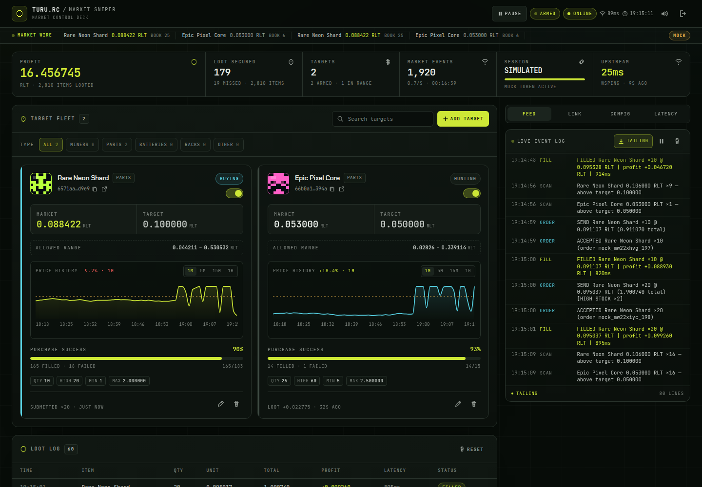
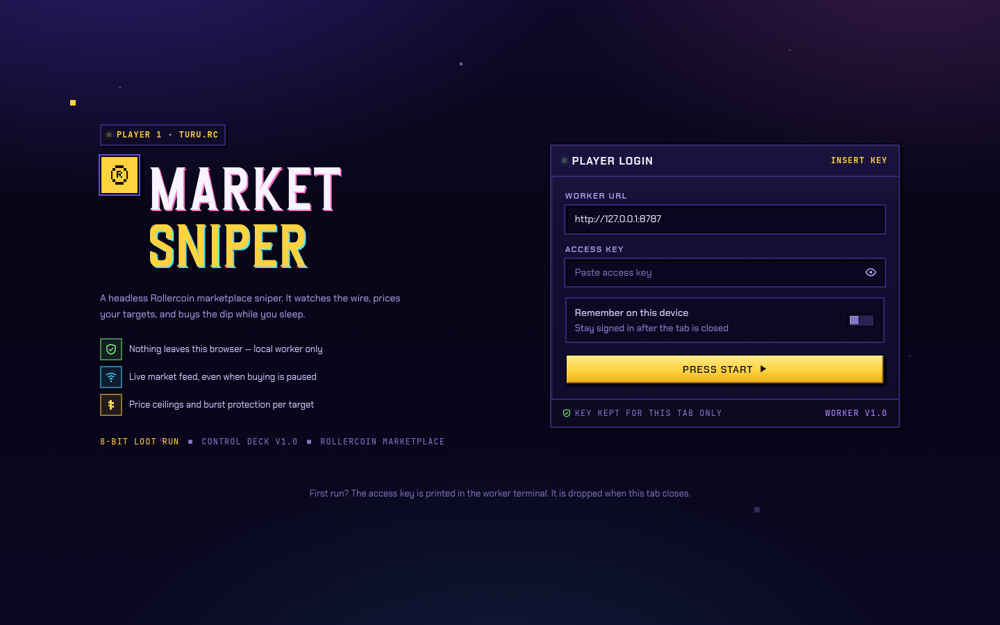
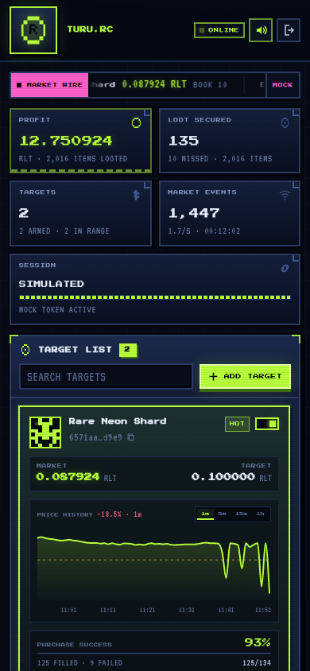
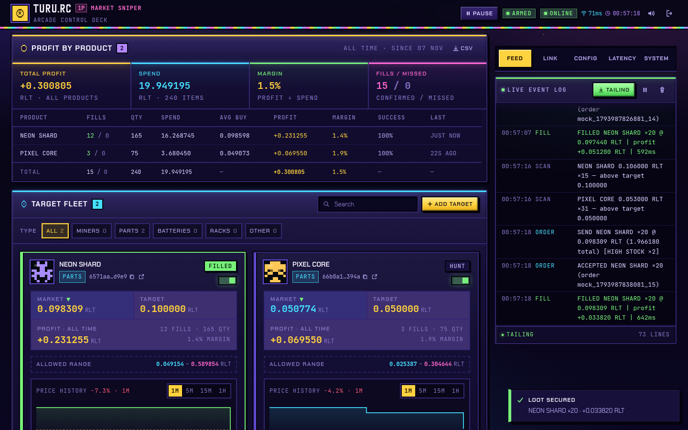

# TURU.RC // MARKET SNIPER

Headless **Rollercoin marketplace sniper** dengan control deck bergaya arcade dan tipografi **Arcana**, dibangun dengan React 19 + Tailwind CSS v4.

> Font UI: **Arcana** oleh vilogsign. File demo di `public/fonts/` gratis untuk penggunaan pribadi; untuk distribusi komersial, beli lisensi penuh dari author.

Dulu `trade.js` harus ditempel di console browser dan ikut melambat saat tab inactive.
Sekarang engine berjalan sebagai proses Node.js terpisah; browser hanya menjadi **data plane**
untuk login, mengatur target, memantau market, dan melihat loot.



| Boot screen | Mobile |
| --- | --- |
|  |  |

---

## Daftar isi

- [Fitur](#fitur)
- [Arsitektur](#arsitektur)
- [Quick start](#quick-start)
- [Jalankan dengan PM2](#jalankan-dengan-pm2)
- [Access key](#access-key)
- [Target configuration](#target-configuration)
- [Mekanisme parameter target](#mekanisme-parameter-target-deep-dive)
- [Link sesi Rollercoin](#link-sesi-rollercoin)
- [Environment variables](#environment-variables)
- [Worker API](#worker-api)
- [HTTPS dan mixed content](#https-dan-mixed-content)
- [Caddy tutorial](#caddy-tutorial-debianubuntu-vps)
- [Data dan keamanan](#data-dan-keamanan)
- [Mock mode](#mock-mode)
- [Testing](#testing)
- [Struktur proyek](#struktur-proyek)
- [Troubleshooting](#troubleshooting)

## Fitur

- **Worker headless** — koneksi WebSocket ke `nws.rollercoin.com`, mendengarkan semua frame,
  mencocokkan event dengan daftar target, lalu menembak `purchase-item` lewat HTTPS.
- **Port + access key** — worker membuka control plane (HTTP + WebSocket) dengan bearer key.
  Key dibuat sekali saat pertama dijalankan, atau dipin lewat `WORKER_TOKEN`.
- **Target dinamis + auto label** — tambah/edit/hapus/arm target dari UI tanpa restart. Label
  diambil otomatis dari `item-info` Rollercoin (`rarityGroup.title.en` + `name.en`); jika
  `rarityGroup` tidak ada, label memakai nama item saja.
- **React chart + success rate** — card memakai chart Recharts minimalist dengan timeframe
  **1m / 5m / 15m / 1h**, garis target, tooltip, dan 24 jam history per menit. Meter price/book
  yang redundan diganti dengan **PURCHASE SUCCESS** per target.
- **React + Vite data plane** — dashboard dibangun dengan React 19 + Recharts; worker menyajikan
  hasil build `dist/` sehingga tetap same-origin dan tanpa CDN runtime.
- **Session manager** — menyimpan access/refresh token, memperbarui token sebelum kedaluwarsa,
  mencoba ulang sekali saat request kena `401`, dan bisa diganti atau **dihapus langsung dari UI**
  (termasuk cookie Cloudflare) tanpa menyentuh `data/state.json` secara manual.
- **Token bridge** — opsional: console snippet sekali pakai atau **userscript Tampermonkey** yang
  dipasang sekali dan otomatis menyinkronkan token setiap 30 detik, bahkan saat tab background.
- **Safety rails** — cooldown antar order, batas order per menit, backoff saat purchase ditolak,
  dry-run, partial-order minimum, validasi ketat, dan konfirmasi untuk aksi destruktif. Tombol
  **PAUSE / START** tunggal di header menghentikan atau menjalankan kembali seluruh proses buying;
  market feed tetap hidup agar harga langsung segar saat di-resume.
- **Loot log + profit report** — setiap fill/failure dicatat, lalu diagregasi permanen per produk
  (fills, qty, spend, avg buy, profit, margin, success rate, last activity). Profit all-time juga
  tampil langsung di tiap product card. Panel **PROFIT BY PRODUCT** bisa diekspor ke CSV; angkanya
  tetap utuh walau loot log sudah berputar melewati `MAX_HISTORY` atau worker restart.
- **Live data plane** — HUD, target cards + chart, market wire, terminal event, loot log, profit
  report, health token, runtime config, sound effect, dan tampilan mobile.
- **Mock mode** — simulator market bawaan untuk mencoba seluruh alur tanpa akun Rollercoin.
- **Test suite** — unit test untuk rules/validation/event/store + integration test end-to-end.

### Profit by product

Agregat per produk tampil di bawah loot log: total profit, spend, margin, lalu tabel per produk
dengan fills/missed, qty, spend, avg buy, profit, margin, success rate, dan aktivitas terakhir.
Setiap product card juga menampilkan **PROFIT · ALL TIME** (dengan fills, qty, dan margin) untuk
item tersebut. Tombol **CSV** mengekspor seluruh baris untuk analisis lanjutan.



---

## Arsitektur

```text
┌──────────────────────────── Browser (data plane) ────────────────────────────┐
│  login access key  ·  target editor  ·  session link  ·  feed  ·  loot log   │
└───────────────▲──────────────────────────────────────────┬───────────────────┘
                │ HTTP + WebSocket (bearer key)             │
┌───────────────┴──────────────────────────────────────────▼───────────────────┐
│ Worker                                                                        │
│  control server · auth · JSON store · matching engine · rate limiter          │
│  session refresh · order history · mock upstream                              │
└───────────────▲──────────────────────────────────────────┬───────────────────┘
                │ WSS market frames                        │ HTTPS purchase + refresh
        wss://nws.rollercoin.com                  https://rollercoin.com/api/*
```

- **Worker** (`src/worker/`) adalah satu-satunya komponen yang menyentuh Rollercoin dan menyimpan
  kredensial. Ia tidak peduli tab browser aktif atau tidak.
- **Data plane** (`ui/` React + Vite → `dist/`, dilayani `ControlServer`) adalah UI + API/event
  stream yang dipakai client. UI disajikan oleh worker agar same-origin, tetapi semua kontrol
  tetap melewati bearer key.
- **Shared rules** (`src/shared/`) berisi validasi, aturan pembelian, dan konstanta yang dipakai
  worker maupun test.

### Alur satu frame market

1. Gateway menerima frame apa pun dari Rollercoin dan menaikkan counter event.
2. Engine menormalkan frame (`marketplace_orders_update`, fill, atau tipe lain).
3. Jika `item_id` cocok dengan target dan currency `RLT`, engine mengambil listing termurah.
4. `planOrder()` memutuskan: harga di bawah target? stok cukup? partial? high-stock ×2?
5. Cooldown global, in-flight guard, dan rate limit dicek.
6. Order dikirim tanpa memblokir frame berikutnya. Order id dicatat untuk menunggu konfirmasi.
7. `marketplace_orders_filled` memperbarui profit, statistik, loot log, dan UI.
8. Semua perubahan penting di-broadcast ke data plane lewat WebSocket.

---

## Quick start

Butuh **Node.js >= 20.19** (dites di Node 24; Vite 8 membutuhkan Node 20.19+).

```bash
npm install
cp .env.example .env      # opsional; edit bila perlu
npm start                 # build React → dist/, lalu jalankan worker
```

Saat pertama kali berjalan, worker mencetak access key satu kali:

```text
  ┌─ ACCESS KEY — SHOWN ONCE, SAVE IT NOW ──────────────────┐
  │ <43-character key>                                      │
  └─────────────────────────────────────────────────────────┘
```

Buka `http://127.0.0.1:8787`, tempel key tersebut, lalu tekan **PRESS START**.

Mau mencoba tanpa akun? Jalankan simulator:

```bash
npm run mock              # build React + worker dalam mode simulasi
```

Satu perintah menyalakan worker dan Vite sekaligus:

```bash
npm run dev               # worker di 127.0.0.1:8787 + Vite di 127.0.0.1:5173
```

Butuh memisahkan prosesnya? Jalankan di dua terminal:

```bash
npm run dev:worker        # worker di 127.0.0.1:8787
npm run dev:ui            # Vite di 5173, proxy /api dan /ws ke 8787
```

Mock mode mengisi dua target contoh, membuat harga naik-turun, dan mengirim fill palsu sehingga
seluruh dashboard bisa diuji offline. Di Windows, set `MOCK=1` di `.env` lalu jalankan `npm start`
(karena script `MOCK=1 ...` memakai sintaks shell Unix).

## Jalankan dengan PM2

PM2 menjalankan worker langsung sebagai proses Node. Build React tetap harus dibuat karena `dist/`
tidak disimpan di repo.

1. Hentikan worker manual yang sedang berjalan (`Ctrl+C`) agar port `8787` bebas.
2. Install PM2 sekali:
   ```bash
   npm install -g pm2
   ```
3. Install dependency dan build UI:
   ```bash
   npm ci
   npm run build
   ```
4. Start process:
   ```bash
   pm2 start ecosystem.config.cjs
   # atau: npm run pm2:start  (build + start/reload)
   ```
5. Verifikasi:
   ```bash
   pm2 status
   curl http://127.0.0.1:8787/api/health
   pm2 logs rc-autotrade --lines 100
   ```
6. Aktifkan auto-start setelah reboot:
   ```bash
   pm2 save
   pm2 startup
   # jalankan command sudo yang dicetak PM2, lalu:
   pm2 save
   ```

> Saat pertama kali berjalan, access key dicetak ke log `pm2 logs rc-autotrade`. Simpan key-nya,
> lalu jangan bagikan isi log. Setelah state ada, key tidak dicetak lagi.

### Update setelah pull

```bash
git pull
npm ci
npm run build
pm2 restart rc-autotrade --update-env
```

### Perintah harian

| Perintah | Fungsi |
| --- | --- |
| `pm2 status` | Lihat status worker |
| `pm2 logs rc-autotrade --lines 100` | Log worker |
| `pm2 restart rc-autotrade --update-env` | Restart setelah `.env`/build berubah |
| `pm2 stop rc-autotrade` | Stop sementara |
| `pm2 delete rc-autotrade` | Hapus dari PM2 |
| `pm2 monit` | Monitor CPU/RAM |

Catatan:

- Gunakan **satu instance** (`fork`), jangan `-i max`/cluster. Worker memegang satu koneksi
  WebSocket dan state order; beberapa instance bisa saling menimpa state dan mengirim order ganda.
- `.env` dibaca oleh worker dari `cwd` (`ecosystem.config.cjs` mengarah ke root project).
- Data target/session dan agregat profit per produk tetap di `data/state.json`; loot log ada di
  `data/loot-log.json`. PM2 restart tidak menghapus keduanya.
- Log default ada di `~/.pm2/logs/`. Jangan commit log karena bisa memuat access key saat boot pertama.
- `pm2 startup` membutuhkan sudo. Jika tidak tersedia, jalankan PM2 dari systemd user service.

### Access key

| Kebutuhan | Cara |
| --- | --- |
| Key pertama kali | Dicetak di terminal, hanya sekali |
| Key tetap | Set `WORKER_TOKEN` (minimal 16 karakter) di `.env` |
| Key hilang | **Stop worker**, lalu `npm run key:reset` |
| Rotasi dari UI | Tab **LINK → ROTATE KEY** (ditolak bila `WORKER_TOKEN` dipin) |
| Ganti key | Semua socket lama dicabut (`4003`) dan client harus login ulang |

> `npm run key:reset` harus dijalankan saat worker berhenti. Kalau worker masih hidup, state
> in-memory-nya bisa menimpa key baru saat shutdown.

---

## Target configuration

Contoh dari brief, bisa langsung dipakai di UI atau `PUT /api/configs`:

```json
[
  {
    "itemId": "6571aa39ca8bfef34adcd9e9",
    "targetPrice": 0.1,
    "desiredQty": 10,
    "highStockThreshold": 20,
    "minAcceptableQty": 1
  }
]
```

| Field | Wajib | Aturan | Arti |
| --- | --- | --- | --- |
| `itemId` | ya | 6–64 karakter `A-Za-z0-9_-`, atau URL marketplace | Item yang diburu |
| `label` | otomatis | maks 48 karakter | Diisi worker dari item-info; UI tidak meminta input manual |
| `itemType` | tidak | default `mutation_component` | Dipakai untuk item-info dan purchase; worker auto-mencoba `mutation_component`, `miner`, `rack`, `battery`, dan mengoreksi dari frame market |
| `rarityColor` | otomatis | 6 digit hex | Warna aksen card, diisi dari `rarityGroup.baseHexColor` bila ada |
| `targetPrice` | ya | > 0, ≤ 1.000.000, maks 6 desimal | Harga maksimum **per unit** (RLT) |
| `desiredQty` | ya | integer 1–10.000 | Qty normal **per order** |
| `highStockThreshold` | ya | integer `desiredQty`–1.000.000 | Book ≥ nilai ini → qty order diminta 2× `desiredQty` |
| `minAcceptableQty` | ya | integer 1..`desiredQty` | Batas bawah partial order |
| `allowPartialOrder` | tidak | boolean, default `true` | Izinkan beli seadanya saat stok < `desiredQty` |
| `maxSpendPerFill` | — | turunan UI, read-only | `targetPrice × desiredQty × 2`, plafon teoretis satu fill |
| `active` | tidak | boolean, default `true` | Arm/disarm target |

Arti detail keempat angka utama, urutan gerbang keputusan, contoh angka, dan kombinasi yang sering
salah dipahami ada di [Mekanisme parameter target](#mekanisme-parameter-target-deep-dive).

Perilaku pembelian:

- Hanya **listing termurah** yang dievaluasi (sama seperti `trade.js` asli), currency `RLT`.
  Listing diurutkan naik berdasarkan harga, lalu qty terbesar lebih dulu pada harga yang sama.
- Jika harga listing termurah di atas `targetPrice`, frame dilewati walau stok melimpah.
- Jika stok cukup, order berisi `desiredQty` (atau 2× saat high-stock aktif); jika stok kurang,
  order hanya terjadi ketika `allowPartialOrder` aktif dan stok >= `minAcceptableQty`.
- Target price dan book diperbarui dari setiap frame market; UI menandai card `HOT` saat harga
  berada di bawah target dan book memenuhi minimum.
- **BOOK** adalah quantity pada listing termurah dari frame market terakhir. Fill sukses
  menguranginya langsung; order gagal **tidak pernah** menambah atau mengubahnya. Angka ini tetap
  dipakai engine (dan ditampilkan di ticker), tetapi card target sekarang menampilkan success rate,
  bukan meter price/book.
- **ALLOWED RANGE** — `allowedPriceMin` / `allowedPriceMax` dari setiap frame market dikonversi dari
  micro-RLT ke RLT dan di-cache per target di runtime worker. Card menampilkan band tersebut, dan
  snapshot `/api/state` tetap membawanya setelah halaman di-reload. Frame baru langsung memperbarui
  nilai cache; frame yang tidak membawa band tidak menghapus nilai lama. Cache hilang saat worker
  restart, sama seperti chart history.
- **PURCHASE SUCCESS** di card = `fills / (fills + failures) × 100%` untuk target tersebut selama
  sesi worker. Order yang masih pending tidak dihitung sampai fill atau gagal terkonfirmasi.
  Reset lifetime stats juga mereset counter per target ini.
- **Chart** menyimpan satu bucket per menit (maks 1.440 bucket = 24 jam) di runtime worker.
  Selector **1m / 5m / 15m / 1h** mengagregasi data di browser; 1m menampilkan 60 menit terakhir,
  1H menampilkan 24 jam. Mock mode mengisi 24 jam awal agar semua timeframe langsung terlihat;
  mode live mulai kosong dan terisi seiring waktu. History runtime hilang saat worker restart.
- **Profit** di dashboard = `(targetPrice - hargaBeli) × qty`, yaitu selisih terhadap harga target,
  bukan hasil penjualan kembali.
- **PROFIT BY PRODUCT** mengagregasi semua fill dan failure per `itemId` ke `state.json`
  (`report.items`). Karena counter disimpan terpisah dari loot log, laporan tetap akurat setelah
  loot log berputar melewati `MAX_HISTORY = 200` dan setelah worker restart. Kolomnya: fills,
  failed, qty, spend, avg buy, profit, margin (`profit / spend`), success rate, dan last activity.
  `DELETE /api/history` mereset report bersama stats; menghapus satu target tidak menghapus
  riwayat produknya. Produk yang disimpan dibatasi `MAX_REPORT_PRODUCTS = 500`; saat daftar penuh,
  produk dengan profit terendah dibuang lebih dulu. Saat upgrade dari state lama tanpa `report`,
  worker membangun ulang laporan sekali dari loot log yang masih tersimpan.

Label otomatis diambil dari:

```http
GET https://rollercoin.com/api/marketplace/item-info?itemId=<id>&itemType=mutation_component&currency=RLT
```

Worker menyusun `label` menjadi `${rarityGroup.title.en} ${name.en}`. `rarityGroup` boleh tidak ada
— fallback-nya adalah `name.en`, lalu `ITEM <short-id>` bila keduanya kosong.

Karena tidak semua item adalah `mutation_component`, resolver mencoba beberapa tipe yang valid
(`mutation_component`, `miner`, `rack`, `battery`) sampai item ditemukan. Saat frame market tiba,
`itemType` dari socket juga dipakai untuk mengoreksi target dan memicu lookup ulang. Contoh:
Rack `63e140e4547cfab9a21d7d2b` akan resolve sebagai **“Jet-Black Rack 6”** meski awalnya
dicoba sebagai `mutation_component`.

Endpoint ini juga tersedia lewat control plane: `GET /api/item-info?itemId=...&itemType=...`.
Jika dipanggil untuk target yang sudah ada, endpoint sekaligus memperbaiki label target tersebut.

---

## Mekanisme parameter target (deep dive)

Form target hanya meminta empat angka, tetapi keputusan beli diambil oleh satu fungsi murni —
`planOrder()` di `src/shared/rules.js` — yang hanya melihat **harga listing termurah**, **stok
listing termurah**, dan config. Tidak ada order book agregat, tidak ada averaging, dan tidak ada
pembatalan order. Bagian ini menjelaskan urutan gerbangnya, arti tiap field, dan kombinasi yang
sering membuat order "tidak jalan".

### Peta label UI ke field

| Label di form target | Field | Inti |
| --- | --- | --- |
| **TARGET PRICE (RLT)** — *Never pay more than this per item.* | `targetPrice` | Plafon harga **per unit** |
| **DESIRED QTY** | `desiredQty` | Qty dasar **per order** |
| **HIGH STOCK THRESHOLD** — *At or above this stock, quantity doubles.* | `highStockThreshold` | Pemicu qty 2× |
| **MIN ACCEPTABLE QTY** — *Partial fills below this are skipped.* | `minAcceptableQty` | Ambang bawah partial |
| **MAX SPEND PER FILL** — *Target price × doubled quantity ceiling.* | turunan (read-only) | Plafon biaya satu fill |
| **ALLOW PARTIAL ORDER** — *Buy whatever is available above the minimum.* | `allowPartialOrder` | Sakelar partial |
| **ARM TARGET** — *Start hunting as soon as it is saved.* | `active` | Arm/disarm target |

### Satu frame = satu keputusan

`engine.js` memanggil `planOrder()` untuk setiap frame market yang cocok. Rantai keputusannya:

```text
frame market (item cocok, currency RLT)
        │
        ▼
listing termurah → unitPrice, available
        │
        ├─ paused ───────────────────────────────────────► skip   paused
        ├─ target inactive ──────────────────────────────► skip   inactive
        ├─ harga tidak valid (NaN / ≤ 0) ────────────────► skip   invalid-price
        ├─ available < 1 ────────────────────────────────► skip   no-stock
        ├─ unitPrice > targetPrice (+1e-9) ──────────────► skip   price-above-target
        ▼
   available >= desiredQty ?
        │
        ├─ ya ─ available >= highStockThreshold ? ──► qty = 2 × desiredQty (doubled)
        │         └─ tidak ─────────────────────────► qty = desiredQty
        │
        └─ tidak ─ allowPartialOrder && available >= minAcceptableQty ?
                    ├─ ya ──────────────────────────► qty = available
                    └─ tidak ───────────────────────► skip   stock-below-minimum
        ▼
qty = clamp(floor(qty), 1 .. min(available, 10 000))
notional = unitPrice × qty
```

Setelah `planOrder()` memutuskan `buy`, masih ada gerbang runtime di `engine.js` yang bisa menahan
order: `paused`, order lain yang belum selesai (`inflight`), backoff setelah rejection
(5s → 10s → 20s → 40s, maksimal 60s), cooldown `delayPerOrder`, batas `maxOrdersPerMinute`, dan
ketersediaan access token (kecuali `dryRun`). Gerbang-gerbang ini **tidak** mengubah qty.

### `targetPrice` — gerbang harga, per unit

| Aspek | Perilaku |
| --- | --- |
| Satuan | RLT per **satu item**, bukan total order |
| Batas | > 0, maks 1.000.000 RLT, maks 6 desimal |
| Dibandingkan dengan | `unitPrice` listing termurah (harga micro-RLT ÷ 1.000.000) |
| Lolos bila | `unitPrice <= targetPrice + 1e-9` (epsilon float, jadi harga yang persis sama tetap dibeli) |
| Ditolak bila | `unitPrice > targetPrice` → `price-above-target`, frame dilewati |

- Anda **tidak** menawar. Kalau listing termurah di bawah target, engine tetap membayar harga
  listing tersebut (bukan `targetPrice`), sehingga biaya nyata ≤ plafon.
- `targetPrice` bukan budget dan bukan batas total. Total satu order = `unitPrice × qty`, dan bisa
  sampai 2× `desiredQty` item saat high-stock aktif — lihat `maxSpendPerFill` di bawah.
- Band harga dari Rollercoin (`allowedPriceMin` / `allowedPriceMax`) hanya **informasi**. Engine
  menyimpannya untuk ditampilkan di card, tetapi tidak pernah dipakai sebagai syarat beli.
- Menurunkan `targetPrice` membuat order lebih jarang tetapi profit per item lebih besar; menaikkan
  mendekati harga pasar membuat order lebih sering dengan margin lebih tipis. Profit yang dicatat
  adalah `(targetPrice − hargaBeli) × qty`, jadi target yang terlalu tinggi juga menggelembungkan
  angka profit.

### `desiredQty` — qty dasar per order

| Aspek | Perilaku |
| --- | --- |
| Tipe | integer 1–10.000 |
| Dipakai saat | `available >= desiredQty`; menjadi dasar doubling |
| Batas nyata | `min(desiredQty, available, 10.000)` saat doubling tidak aktif |
| Bukan | target harian, total pembelian, atau plafon saldo |

- Ini angka **per order**, bukan "beli 50 lalu berhenti". Setiap frame market berikutnya yang lolos
  bisa memicu order baru; yang membatasi adalah cooldown, `inflight`, dan rate limit.
- Kalau `available < desiredQty`, `desiredQty` tidak dipakai untuk memotong qty; cabang partial
  mengambil `available` apa adanya (bila diizinkan).
- Nilai `desiredQty` besar tidak memaksa satu order raksasa: dengan `desiredQty = 5.000` dan book
  60, qty tetap 60 saat partial aktif — atau tidak ada order sama sekali saat partial dimatikan.

### `highStockThreshold` — pemicu qty 2×

| Aspek | Perilaku |
| --- | --- |
| Tipe | integer, `>= desiredQty`, maks 1.000.000 |
| Kondisi aktif | `available >= highStockThreshold` |
| Efek | qty **diminta** menjadi 2× `desiredQty` (bukan 2× threshold) |
| Batas | tetap `min(2 × desiredQty, available, 10.000)` |

Contoh dengan `desiredQty = 50`, `highStockThreshold = 100`:

| `available` | qty | `doubled` | Catatan |
| --- | --- | --- | --- |
| 49 | 49 | tidak | partial order |
| 50 | 50 | tidak | pas desiredQty |
| 99 | 50 | tidak | stok belum menyentuh threshold |
| 100 | 100 | ya | 2× desiredQty, masih tertutup stok |
| 150 | 100 | ya | plafon 2× desiredQty |

Dengan `highStockThreshold = 60` dan `available = 70`, engine meminta 100 tetapi memotongnya menjadi
70 — doubling tetap "sebanyak stok yang ada", bukan paksa 2×.

Hal yang sering keliru:

- Doubling **tidak** berarti qty = 2× `available`; ia hanya meminta 2× `desiredQty`.
- `highStockThreshold == desiredQty` membuat fitur menyala setiap kali stok cukup, sehingga qty
  dasar `desiredQty` praktis tidak pernah dipakai (selalu 2× atau dipotong stok).
- Threshold yang jauh di atas book normal (misal 10.000 untuk item sepi) membuat fitur ini tidak
  pernah aktif — tidak ada efek samping lain.
- Threshold dihitung dari stok listing termurah pada frame itu, bukan akumulasi beberapa listing.
- Saat fill sukses, book runtime dikurangi qty fill; frame market berikutnya bisa mengembalikan book
  ke angka asli bila memang ada stok baru. Jadi doubling bisa menyala-mati antar frame.
- Qty hasil doubling tetap dibatasi `10.000`, jadi `desiredQty` di atas 5.000 tidak akan pernah
  menghasilkan 2× penuh.

### `minAcceptableQty` + `allowPartialOrder` — kapan boleh beli seadanya

Keduanya hanya bekerja sebagai pasangan. `allowPartialOrder` adalah sakelar, `minAcceptableQty`
adalah ambang batas bawahnya.

| Stok tersedia (`available`) | `allowPartialOrder = true` | `allowPartialOrder = false` |
| --- | --- | --- |
| `>= highStockThreshold` | 2× `desiredQty` (dipotong stok) | sama |
| `>= desiredQty`, `< threshold` | `desiredQty` | sama |
| `>= minAcceptableQty`, `< desiredQty` | `available` (partial fill) | **skip** `stock-below-minimum` |
| `< minAcceptableQty` | **skip** `stock-below-minimum` | **skip** `stock-below-minimum` |

- `minAcceptableQty` hanya dievaluasi di cabang stok kurang dari `desiredQty`. Ia tidak membatasi
  qty saat stok cukup, dan tidak mempengaruhi doubling.
- Saat partial aktif, qty = seluruh `available` (bukan `minAcceptableQty`). `minAcceptableQty = 5`
  dengan stok 40 dan `desiredQty = 50` menghasilkan order 40, bukan 5.
- `allowPartialOrder = false` membuat `minAcceptableQty` tidak relevan sama sekali: stok di bawah
  `desiredQty` selalu dilewati.
- `minAcceptableQty = desiredQty` adalah cara lain mematikan partial tanpa mengubah switch: partial
  tidak akan pernah memenuhi syarat karena `available < desiredQty` berarti `available < min`.
- Partial fill lebih mahal per usaha: satu order menghabiskan satu slot cooldown dan satu slot rate
  limit, berapa pun qty-nya. Menurunkan `minAcceptableQty` menambah jumlah order kecil.

> Catatan `HOT`: card menandai `HOT` saat target aktif, harga ≤ `targetPrice`, dan
> `lastStock >= minAcceptableQty`. Penanda ini sengaja longgar sebagai petunjuk "harga masuk".
> Keputusan final tetap `planOrder()`; dengan `allowPartialOrder = false` sebuah card bisa tampak
> `HOT` padahal engine melewatinya karena stok < `desiredQty`. Event `market` di WebSocket memakai
> definisi yang lebih ketat: `hot = plan.action === "buy"`.

### `maxSpendPerFill` — plafon teoretis, bukan field

Nilai abu-abu di form target **tidak dikirim** ke worker dan tidak disimpan di `state.json`. UI
menghitungnya sebagai `targetPrice × desiredQty × 2` supaya Anda bisa melihat skenario terburuk
satu fill: harga pas di target **dan** high-stock menyala.

```text
maxSpendPerFill = targetPrice × desiredQty × 2
biaya sebenarnya = unitPrice × qty  ≤  maxSpendPerFill
```

- Kalau ingin aman terhadap saldo, pastikan saldo RLT ≥ total `maxSpendPerFill` dari semua target
  yang armed, karena beberapa target bisa menembak hampir bersamaan.
- Worker tidak mengecek saldo sebelum order. Bila saldo kurang, purchase bisa ditolak marketplace;
  target lalu masuk backoff dan tercatat sebagai failure.
- Plafon ini hanya bergantung pada `targetPrice` dan `desiredQty` (faktor 2 selalu dihitung),
  sehingga menurunkan `highStockThreshold` tidak menurunkan plafon.

### Contoh lengkap (config di screenshot)

`targetPrice = 0.012`, `desiredQty = 50`, `highStockThreshold = 100`, `minAcceptableQty = 5`,
`allowPartialOrder = true`, sehingga `maxSpendPerFill = 1.200000 RLT`:

| Frame market | Keputusan | Alasan |
| --- | --- | --- |
| harga 0.0115, stok 60 | buy 50 | stok ≥ 50, < 100 |
| harga 0.0115, stok 120 | buy 100 | stok ≥ 100 → doubled, total ≤ 1.2 RLT |
| harga 0.0115, stok 40 | buy 40 | partial (40 ≥ 5) |
| harga 0.0115, stok 4 | skip | `stock-below-minimum` |
| harga 0.0125, stok 500 | skip | `price-above-target` |
| harga 0.0120, stok 100 | buy 100 | harga tepat di target tetap lolos (epsilon) |
| sama, `allowPartialOrder = false`, stok 40 | skip | partial dimatikan |

### Resep tuning

| Tujuan | `desiredQty` | `highStockThreshold` | `minAcceptableQty` | Partial |
| --- | --- | --- | --- | --- |
| Sniper konservatif, order kecil | 10 | 20 | 1 | on |
| Borong saat book tebal | 50 | 100 | 5 | on |
| Hanya mau lot penuh | 50 | 100 | 50 | off |
| Hindari pecahan receh | 20 | 40 | 10 | on |
| Uji strategi tanpa risiko | apa saja | apa saja | apa saja | apa saja + `dryRun` |

Aturan praktis:

- `minAcceptableQty = 1` memaksimalkan jumlah fill, tetapi banyak order 1-item yang menghabiskan
  cooldown.
- `minAcceptableQty` mendekati `desiredQty` memberi fill lebih jarang dengan qty lebih padat.
- `highStockThreshold = 2 × desiredQty` adalah nilai paling intuitif: doubling hanya aktif saat book
  benar-benar dua kali lipat kebutuhan normal.
- Selalu cek `maxSpendPerFill` terhadap saldo sebelum meng-arm banyak target sekaligus.

### Reason code yang muncul di log

| Reason | Arti | Perbaikan |
| --- | --- | --- |
| `paused` | PAUSE global aktif | Resume dari header |
| `inactive` | Target di-disarm | Arm target |
| `invalid-price` | Harga frame tidak valid / ≤ 0 | Tunggu frame berikutnya |
| `no-stock` | Book kosong | Tunggu restock |
| `price-above-target` | Harga termurah > `targetPrice` | Naikkan target atau tunggu harga turun |
| `stock-below-minimum` | Stok < `desiredQty` dan syarat partial tidak terpenuhi | Turunkan `minAcceptableQty`, aktifkan partial, atau turunkan `desiredQty` |

`planOrder()` sendiri tidak mengembalikan alasan untuk gerbang runtime (`inflight`, cooldown,
rate limit, backoff, no-token); kondisi itu terlihat di log `scan`/`order` dan di state card.

### Di mana di kode

| Bagian | Lokasi |
| --- | --- |
| Keputusan beli murni | `planOrder()` di `src/shared/rules.js` |
| Validasi & normalisasi field | `validateTarget()` di `src/shared/validation.js` |
| Gerbang runtime + eksekusi | `#handleMarket()` / `#submit()` di `src/worker/engine.js` |
| Preview `maxSpendPerFill` | `TargetModal` di `ui/src/components/Modals.jsx` |
| Penanda `HOT` di card | `runtimeHot()` di `ui/src/lib/format.js` |

---

## Link sesi Rollercoin

### Cara manual

1. Login ke `rollercoin.com` di browser.
2. DevTools → **Application → Local Storage → https://rollercoin.com**.
3. Salin nilai `token` dan `refreshToken`.
4. Buka tab **LINK → PASTE TOKEN** di control deck.
5. Isi cookie Cloudflare hanya jika API purchase ditolak (lihat troubleshooting).

Worker menyimpan access + refresh token di `data/state.json` (mode `0600`) dan otomatis
memperbarui access token **2 menit sebelum** JWT kedaluwarsa. Token Rollercoin umumnya berumur
600 detik, jadi refresh terjadi sekitar tiap 8 menit — bukan tiap 30 detik. Untuk token opaque,
fallback-nya tiap 25 menit. Refresh terjadwal **tidak** menutup/membuka ulang market socket;
socket hanya di-reconnect saat statusnya tidak online atau saat token diganti manual/bridge.
Tombol **REFRESH NOW** memaksa refresh. Jika refresh gagal, status berubah menjadi `TOKEN ERROR`
dan token baru harus ditempel ulang.

> Bridge tetap mengirim POST `/api/session/push` tiap 30 detik. Itu sinkronisasi token HTTP,
> bukan reconnect WebSocket.

### Token bridge — pilih salah satu

Bridge **tidak wajib**. Kalau Anda hanya ingin worker berjalan, tempel token sekali di tab **LINK**;
worker menyimpannya dan memperbarui sendiri selama refresh token masih valid. Bridge berguna saat
Anda juga membuka Rollercoin dan ingin `localStorage` situs tetap sinkron dengan worker.

Tab **LINK → TOKEN BRIDGE** sekarang punya dua mode:

#### 1. Userscript — pasang sekali, jalan otomatis (disarankan)

1. Install **Tampermonkey** (atau Violentmonkey) di browser.
2. Buka control deck → **LINK → TOKEN BRIDGE** → tab **USERSCRIPT · AUTO**.
3. Klik **COPY USERSCRIPT** atau **DOWNLOAD .USER.JS**.
4. Tampermonkey Dashboard → **+** (script baru) → paste → **Ctrl+S**.
5. Buka `rollercoin.com` dalam keadaan login. Userscript otomatis mulai, mengirim token tiap
   30 detik, dan restart sendiri setiap halaman di-reload.
6. Biarkan tab Rollercoin terbuka (boleh inactive). Worker tetap mengeksekusi order.

Setelah ini alur harian Anda hanya: **nyalakan worker → buka Rollercoin seperti biasa**. Tidak perlu
paste token lagi selama refresh token masih hidup.

> Jika access key dirotasi atau worker diganti domain/port, buka bridge lagi dan pasang userscript
> baru. File userscript memuat access key + URL worker; jangan dibagikan.
>
> Userscript memakai `GM_xmlhttpRequest`, sehingga tidak terkena CORS/CSP halaman Rollercoin.
> Jika Tampermonkey meminta izin koneksi ke `127.0.0.1`, pilih **Allow**. Kalau sebelumnya sudah
> memasang userscript versi lama, regenerate dan ganti script-nya — versi lama masih memakai
> `fetch` biasa.

#### 2. Console snippet — sekali pakai

1. Buka `rollercoin.com` yang sudah login.
2. DevTools → **Console** → paste snippet → Enter.
3. Bridge berjalan sampai halaman di-reload. Setelah reload, paste ulang.

#### Yang dilakukan bridge

Setiap 30 detik:

1. Mengirim `token`/`refreshToken` dari `localStorage` Rollercoin ke worker.
2. Menerima balik token yang lebih baru dari worker.
3. Menulis token baru ke `localStorage` Rollercoin bila berbeda.

Dengan begitu worker dan tab Rollercoin tidak saling menimpa token. Worker tetap melakukan refresh
sendiri; bridge hanya menjembatani localStorage. Hentikan dengan `__TURU_RC_BRIDGE__.stop()`.

> Kedua mode memuat access key control deck. Jangan bagikan screenshot/console yang memuatnya.
> CORS dan Private Network Access diizinkan untuk endpoint push, tetapi tetap membutuhkan bearer key.
> Jika halaman Rollercoin HTTPS tidak bisa menghubungi worker HTTP, gunakan URL `localhost`/
> `127.0.0.1` atau pasang worker di balik HTTPS.

### Cookie Cloudflare

Purchase dari Node tidak membawa cookie browser. Bila Rollercoin membalas `403`/halaman challenge,
salin header cookie dari request browser (minimal `cf_clearance`, sering juga `__cf_bm`) ke field
**CLOUDFLARE COOKIE** atau `RC_COOKIE`. Cookie dan IP harus cocok; ini bukan jaminan bypass.

---

## Environment variables

| Variable | Default | Keterangan |
| --- | --- | --- |
| `HOST` | `127.0.0.1` | Bind address control plane |
| `PORT` | `8787` | Port control plane (`0` = pilih acak) |
| `WORKER_TOKEN` | — | Pin access key (>= 16 karakter) |
| `DATA_DIR` | `./data` | Lokasi `state.json` dan `loot-log.json` |
| `RC_API_BASE` | `https://rollercoin.com` | Base URL API |
| `RC_WS_URL` | `wss://nws.rollercoin.com/` | URL market socket |
| `RC_COOKIE` | — | Cookie header awal (bisa juga dari UI) |
| `RC_HTTP_KEEPALIVE_MS` | `60000` | Idle timeout socket keep-alive (1000–600000 ms) |
| `RC_HTTP_CONNECTIONS` | `8` | Maksimum koneksi per origin (1–32) |
| `RC_KEEPALIVE_MS` | `30000` | Interval warm probe; `0` = mati (5000–600000 ms) |
| `RC_KEEPALIVE_URL` | `${RC_API_BASE}/api/events/config` | Endpoint probe publik |
| `MOCK` | `0` | `1` = simulator, tidak ada order nyata |
| `LOG_LEVEL` | `info` | `debug`, `info`, `warn`, `error` |

Semua request API memakai satu pool keep-alive. Warm probe hanya dikirim bila tidak ada request
nyata dalam ~90% interval, memakai `GET` publik (bukan payload palsu), dan otomatis berhenti
5 menit bila menerima `403`/`429`.

### Latency worker → upstream

Worker mengukur RTT ke Rollercoin secara pasif di empat channel — tidak ada request tambahan
yang dikirim hanya untuk pengukuran:

| Channel | Sumber sampel |
| --- | --- |
| `HTTP` | Purchase, item-info, token refresh (termasuk yang gagal/timeout) |
| `WARM PROBE` | Warm probe keepalive (`GET` periodik) |
| `WS HANDSHAKE` | Koneksi socket market feed (connect → open) |
| `WS PING` | Ping/pong heartbeat socket market feed (~25 detik sekali) |

Setiap channel menyimpan sampel berjalan (maks 120) dan diekspos sebagai last/avg/p50/p95/min/max/
jitter + sparkline di tab **LATENCY** control deck (pratinjau ringkas juga ada di HUD). Panel ini
live update: worker broadcast view latency terbaru tiap 5 detik lewat control socket, dan tab
LATENCY juga mem-poll `GET /api/latency` tiap 10 detik sebagai fallback. Call yang
gagal tetap dihitung karena tetap memakai waktu upstream. Tombol **UKUR SEKARANG** menjalankan
warm probe on-demand via `POST /api/latency/probe`. `DELETE /api/history` menghapus sampel latency
bersama statistik lainnya.

`HOST=0.0.0.0` memungkinkan akses dari LAN. Jangan lakukan itu tanpa firewall/TLS, dan ingat
control deck memegang kredensial Rollercoin.

---

## Worker API

Semua endpoint kecuali `/api/health` membutuhkan:

```http
Authorization: Bearer <access-key>
```

| Method | Path | Fungsi |
| --- | --- | --- |
| `GET` | `/api/health` | Health publik (tanpa auth) |
| `GET` | `/api/state` | Snapshot lengkap: config, runtime, stats, report, session, history |
| `GET` | `/api/report` | Agregat profit per produk all-time (`totals` + `items`) |
| `GET` | `/api/item-info?itemId=&itemType=` | Resolve label/rarity/itemType dari marketplace |
| `GET` | `/api/configs` | Daftar target + runtime |
| `PUT` | `/api/configs` | Ganti seluruh daftar (`[ ... ]` atau `{ "configs": [ ... ] }`) |
| `POST` | `/api/configs` | Tambah satu target |
| `PATCH` | `/api/configs/:itemId` | Update parsial / arm-disarm |
| `DELETE` | `/api/configs/:itemId` | Hapus target |
| `PATCH` | `/api/settings` | `delayPerOrder`, `maxOrdersPerMinute`, `dryRun`, `paused`, `autoRefresh` |
| `POST` | `/api/control` | `{ "action": "pause" \| "resume" \| "toggle" \| "reconnect" }` |
| `POST` | `/api/session` | Simpan access/refresh token dan/atau cookie; `clearAccessToken`/`clearRefreshToken`/`clearCookie` untuk menghapus |
| `DELETE` | `/api/session` | Hapus access token, refresh token, dan cookie sekaligus |
| `POST` | `/api/session/push` | Endpoint bridge (CORS); balas token terbaru |
| `POST` | `/api/session/refresh` | Refresh paksa |
| `POST` | `/api/auth/rotate` | Rotasi access key (409 bila dipin env) |
| `GET` | `/api/latency` | Statistik latency worker → upstream per channel (HTTP, warm probe, WS handshake, WS ping) |
| `POST` | `/api/latency/probe` | Jalankan warm probe sekarang dan balas sampel baru |
| `DELETE` | `/api/history` | Reset profit, counter, loot log, dan sampel latency |

Error validasi memakai status `422` dan `fields`, misalnya:

```json
{
  "ok": false,
  "error": "Target is invalid.",
  "fields": {
    "highStockThreshold": "High-stock threshold must be greater than or equal to desired quantity."
  }
}
```

### WebSocket

- URL: `ws://<host>:<port>/ws`
- Auth: subprotocol `rcw.v1, <access-key>` (fallback query `?token=...`)
- Client boleh mengirim `{ "type": "ping", "t": 123 }`; server membalas `{ "type": "pong", ... }`.
- Event server: `hello`, `snapshot`, `log`, `market`, `order`, `history`, `stats`, `report`,
  `session`, `gateway`, `settings`, `configs`, `latency`, `history-cleared`.
- `order.phase`: `submitted`, `accepted`, `filled`, `failed`, `dry`.
- `market` membawa `price`, `stock`, `targetPrice`, `hot`, `at`, serta `allowedPriceMin`,
  `allowedPriceMax`, `allowedAt` (cache band harga terakhir per target).

---

## HTTPS dan mixed content

Jika control deck dibuka lewat `http://<IP-publik>:8787`, bridge yang berjalan di halaman
`https://rollercoin.com` akan diblokir browser:

```text
Mixed Content: ... requested an insecure resource 'http://18.205.189.239:8787/api/session/push'
```

Ini bukan masalah CORS dan tidak bisa diperbaiki dari JavaScript. Halaman HTTPS tidak boleh
memanggil HTTP non-loopback. Cara paling mudah dan rapi adalah menaruh **Caddy** di depan worker
sebagai reverse proxy HTTPS.

Caddy menangani:

- sertifikat Let's Encrypt otomatis,
- redirect HTTP → HTTPS,
- WebSocket `/ws` tanpa konfigurasi tambahan,
- header CORS dari worker tetap diteruskan.

---

## Caddy tutorial (Debian/Ubuntu VPS)

Contoh di bawah memakai IP `18.205.189.239` dan domain gratis `18.205.189.239.sslip.io`.
Ganti dengan domain sendiri jika ada.

### 1. Prasyarat

- Port **80** dan **443** terbuka di firewall/security group.
- Domain A record mengarah ke IP server. Tanpa domain, `<IP>.sslip.io` otomatis mengarah ke IP
  tersebut.
- Worker berjalan di `127.0.0.1:8787`.
- Tidak ada Apache/Nginx lain yang memakai port 80/443.

Cek DNS dari server:

```bash
getent hosts 18.205.189.239.sslip.io
# atau
dig +short 18.205.189.239.sslip.io
```

Cek port yang sedang dipakai:

```bash
sudo ss -ltnp | grep -E ':(80|443|8787)\b' || true
```

### 2. Install Caddy

Jika Caddy belum ada, gunakan repo resmi Caddy:

```bash
sudo apt install -y debian-keyring debian-archive-keyring apt-transport-https curl gnupg
curl -1sLf 'https://dl.cloudsmith.io/public/caddy/stable/gpg.key' \
  | sudo gpg --dearmor -o /usr/share/keyrings/caddy-stable-archive-keyring.gpg
curl -1sLf 'https://dl.cloudsmith.io/public/caddy/stable/debian.deb.txt' \
  | sudo tee /etc/apt/sources.list.d/caddy-stable.list
sudo apt update
sudo apt install -y caddy
caddy version
```

Caddy otomatis membuat service systemd. Cek:

```bash
sudo systemctl status caddy --no-pager
```

### 3. Bind worker ke loopback

Di `.env` project:

```env
HOST=127.0.0.1
PORT=8787
```

Restart worker:

```bash
pm2 restart rc-autotrade --update-env
curl http://127.0.0.1:8787/api/health
```

Kalau worker dijalankan manual:

```bash
# Ctrl+C worker lama
npm start
```

> Jangan biarkan worker tetap listen di `0.0.0.0:8787`. Setelah Caddy aktif, port 8787 tidak boleh
> terbuka ke internet.

### 4. Buat Caddyfile

```bash
sudo nano /etc/caddy/Caddyfile
```

Isi:

```caddyfile
18.205.189.239.sslip.io {
    reverse_proxy 127.0.0.1:8787
}
```

Untuk domain sendiri:

```caddyfile
rc.example.com {
    reverse_proxy 127.0.0.1:8787
}
```

Caddy **tidak perlu** konfigurasi WebSocket khusus; `reverse_proxy` meneruskan upgrade HTTP
secara otomatis. Jika memakai Cloudflare di depan domain, set DNS ke **DNS only (grey cloud)**
saat pertama kali agar challenge sertifikat Caddy tidak terhalang.

### 5. Validasi dan jalankan

```bash
sudo caddy validate --config /etc/caddy/Caddyfile
sudo systemctl enable --now caddy
sudo systemctl reload caddy
sudo systemctl status caddy --no-pager
```

Lihat proses penerbitan sertifikat:

```bash
sudo journalctl -u caddy -f
```

Tunggu sampai muncul sertifikat untuk domain/IP. Setelah itu cek:

```bash
curl -I https://18.205.189.239.sslip.io
curl -s https://18.205.189.239.sslip.io/api/health
```

Buka control deck:

```text
https://18.205.189.239.sslip.io
```

### 6. Tutup port 8787 dari internet

Di UFW:

```bash
sudo ufw allow 80/tcp
sudo ufw allow 443/tcp
sudo ufw deny 8787/tcp
sudo ufw status
```

Di security group cloud (AWS/GCP/Azure), hapus inbound `8787` dan izinkan `80/443`.

Verifikasi dari mesin lain, bukan dari server:

```bash
curl -m 3 http://18.205.189.239:8787/api/health
# harus timeout / connection refused
```

### 7. Generate ulang bridge

Bridge lama masih berisi URL HTTP. Setelah HTTPS aktif:

1. Buka deck via `https://...`.
2. Masuk **LINK → TOKEN BRIDGE**.
3. Pilih **USERSCRIPT · AUTO** (lebih tahan CSP) atau console snippet.
4. Generate ulang, lalu ganti userscript lama di Tampermonkey.
5. Pastikan URL di dalam script sudah `https://...`, bukan `http://18.205...`.

Caddy meneruskan endpoint `/api/session/push` beserta header CORS-nya, jadi bridge tetap bekerja.

### 8. Auto-start

Caddy memakai systemd, worker memakai PM2:

```bash
sudo systemctl enable caddy
pm2 save
pm2 startup
# jalankan command sudo yang dicetak PM2, lalu:
pm2 save
```

Urutan startup tidak masalah: Caddy bisa hidup lebih dulu; selama worker belum hidup, request akan
mendapat `502` sementara.

### 9. Update konfigurasi

Setelah mengubah Caddyfile:

```bash
sudo caddy validate --config /etc/caddy/Caddyfile
sudo systemctl reload caddy
```

Setelah mengubah `.env`/kode worker:

```bash
npm run build
pm2 restart rc-autotrade --update-env
```

### Troubleshooting Caddy

| Gejala | Solusi |
| --- | --- |
| Sertifikat gagal diterbitkan | DNS belum mengarah ke IP, port 80/443 tertutup, atau Cloudflare proxy aktif. Cek `journalctl -u caddy -n 100 --no-pager`. |
| `502 Bad Gateway` | Worker mati atau bukan di `127.0.0.1:8787`. Jalankan `curl http://127.0.0.1:8787/api/health`. |
| Halaman 404/blank | `dist/` belum dibuild. Jalankan `npm run build`, lalu restart worker/PM2. |
| WebSocket offline | Pastikan hanya Caddy yang memakai 443 dan tidak ada proxy lain. Caddy menangani `/ws` otomatis. |
| Masih mixed content | Masih membuka deck/bridge dari URL `http://18.205...`. Buka via HTTPS, hard refresh, lalu generate ulang snippet/userscript. |
| `address already in use` | Apache/Nginx lain memakai 80/443. Stop service tersebut atau gunakan Caddy di port lain + firewall. |
| Caddyfile error | `sudo caddy validate --config /etc/caddy/Caddyfile`; lihat pesan baris yang salah. |
| 8787 masih bisa diakses publik | `HOST` masih `0.0.0.0`, firewall/security group belum menutup 8787. |

### Alternatif tanpa Caddy

- **Cloudflare Tunnel**: `cloudflared tunnel --url http://127.0.0.1:8787`, lalu pakai URL
  `https://<acak>.trycloudflare.com`. Cocok jika port 80/443 tidak bisa dibuka.
- **SSH tunnel**: `ssh -N -L 8787:127.0.0.1:8787 user@18.205.189.239`, lalu buka
  `http://127.0.0.1:8787`. Loopback HTTP dikecualikan dari mixed content dan token lewat SSH.

> Jangan mengakali mixed content dengan memaksa `GM_xmlhttpRequest` ke HTTP publik. Secara teknis
> userscript bisa melewati aturan halaman, tetapi access key dan token Rollercoin dikirim plaintext
> lewat internet. Gunakan HTTPS, tunnel, atau SSH.

> Kalau worker sempat diakses lewat HTTP publik, rotasi access key (**LINK → ROTATE KEY**) dan
> tempel ulang session Rollercoin setelah HTTPS aktif.

---

## Data dan keamanan

- `data/state.json` berisi token sesi Rollercoin (plaintext), target, settings, dan statistik.
  **Tidak** lagi menyimpan loot log.
- `data/loot-log.json` berisi history fill/failure (maks 200 entri) dan ditulis terpisah dengan
  atomic write. Kedua file dibuat `0600`, direktori `0700`.
- Saat pertama start setelah update, history lama di `state.json` otomatis dimigrasikan ke
  `loot-log.json`, lalu `state.json` ditulis ulang tanpa field `history`. Jangan commit atau backup
  isi `data/` ke tempat publik.
- Access key worker **tidak** disimpan plaintext; hanya hash SHA-256 + preview.
- Token Rollercoin tidak pernah dikirim ke UI dalam bentuk penuh; UI hanya menampilkan preview.
  Pengecualian: `/api/session/push` membalas token penuh ke snippet bridge yang sudah terautentikasi.
- Semua percobaan auth yang gagal dibatasi 20/menit per IP.
- Default bind loopback. Untuk akses remote, pakai reverse proxy HTTPS + firewall; jangan buka
  port mentah ke internet.
- Tidak ada telemetry, analytics, atau koneksi ke server pihak ketiga selain Rollercoin.
- Proyek ini tidak berafiliasi dengan Rollercoin. Gunakan dengan risiko sendiri dan patuhi ToS.

---

## Mock mode

```bash
npm run mock
```

- Mengisi dua target contoh bila state kosong.
- Membuat sesi JWT palsu (agar panel token tetap hidup).
- Harga berfluktuasi di sekitar target; setiap siklus tertentu turun ke bawah target.
- Purchase disimulasikan: 8% gagal, sisanya fill setelah 0.5–1.4 detik.
- Tidak ada request keluar ke Rollercoin.

Mock juga dipakai oleh integration test, jadi `npm test` tidak membutuhkan akun atau network.

---

## Testing

```bash
npm test
```

`pretest` otomatis menjalankan `vite build` terlebih dahulu, jadi integration test selalu memakai
UI React yang sedang aktif.

Cakupan:

- `validation.test.js` — schema target, URL, duplikat, settings, session.
- `rules.test.js` — price/qty/high-stock/partial, rate limiter, konversi micro-RLT.
- `events.test.js` — normalisasi frame market, fill, dan frame lain.
- `store.test.js` — key generation/rotation, persistensi, sanitasi state, JWT exp.
- `bridge.test.js` — transport `GM_xmlhttpRequest` + sinkronisasi token dua arah.
- `item-info.test.js` — auto label, fallback tanpa `rarityGroup`, deteksi tipe (rack), cache, kegagalan API.
- `engine.test.js` — order gagal tidak menambah book; fill sukses menguranginya.
- `keepalive.test.js` — warm probe, idle timeout, dan suspend saat `403`/`429`.
- `latency.test.js` — rolling sample per channel, percentile, dan jitter.
- `report.test.js` — agregat profit per produk bertahan setelah loot log berputar.
- `format.test.js` — formatter UI (label itemType, URL marketplace).
- `session.test.js` — jadwal refresh token dan fallback token opaque.
- `integration.test.js` — spawn worker mock, auth, CRUD, settings, CORS, session push, item-info, WS, fill.

Total 78 test; integration test memakai port acak dan data directory sementara.

---

## Struktur proyek

```text
.
├── ui/                      # data plane React + Vite
│   ├── index.html           # entry + SVG icon sprite
│   └── src/
│       ├── App.jsx          # dashboard, panels, cards
│       ├── useWorker.js     # snapshot/WS/actions state
│       ├── useToasts.js
│       ├── components/      # PriceChart (Recharts), modals
│       ├── lib/             # client, format, sound
│       └── styles.css       # entry Tailwind v4 + token desain
├── public/                  # aset statis (bridge.js, favicon, fallback)
├── dist/                    # hasil build Vite yang disajikan worker
├── src/
│   ├── shared/
│   │   ├── constants.js
│   │   ├── rules.js         # planOrder + rate limiter
│   │   └── validation.js
│   └── worker/
│       ├── index.js         # bootstrap, graceful shutdown
│       ├── config.js        # env loader
│       ├── logger.js        # console + socket log buffer
│       ├── store.js         # atomic JSON state, token hash
│       ├── http.js          # shared keep-alive dispatcher + fetch
│       ├── api.js           # Rollercoin HTTP client
│       ├── keepalive.js     # warm probe with backoff/suspend
│       ├── session.js       # token refresh scheduler
│       ├── gateway.js       # real WSS client + reconnect
│       ├── mock.js          # simulator upstream
│       ├── engine.js        # matching + order execution + 24h minute history
│       ├── item-info.js     # auto label/rarity resolver
│       ├── events.js        # upstream frame normalizer
│       ├── server.js        # control plane HTTP/WS + static UI
│       └── reset-token.js
├── test/
├── docs/                    # screenshot
├── vite.config.js           # root ui/, output dist/
├── package.json
├── trade.js                 # script asli (referensi)
├── test.json                # contoh konfigurasi
└── .env.example
```

---

## Troubleshooting

| Gejala | Penyebab / solusi |
| --- | --- |
| `ACCESS DENIED` saat login | Key salah atau sudah dirotasi. Cek terminal; reset dengan `npm run key:reset` (worker harus berhenti). |
| `429` saat login | Terlalu banyak key salah. Tunggu 1 menit. |
| Halaman menampilkan “REACT DECK READY” atau 404 | Worker lama masih menyajikan `public/`. Restart dengan `Ctrl+C` lalu `npm start` agar worker menyajikan `dist/` React. |
| `LINK LOST` | Control WebSocket putus. Worker mati? Cek proses/port. |
| `FEED DOWN` / `SYNCING` | Worker hidup tetapi socket Rollercoin belum tersambung. Cek log, token, jaringan. |
| `NO TOKEN` | Belum ada sesi Rollercoin. Buka tab LINK dan tempel token. |
| `AUTH ERR` | Token ditolak Rollercoin. Tempel sesi baru; cek cookie/UA bila perlu. |
| Purchase `403` / HTML challenge | Cloudflare. Isi cookie dari browser; pastikan IP/UA wajar. |
| Bridge `CORS` / `Failed to fetch` | Console mode memakai `fetch` halaman dan bisa diblokir CSP/Private Network Access. Pakai **USERSCRIPT · AUTO** (memakai `GM_xmlhttpRequest`). Pastikan URL bridge `http://127.0.0.1:<port>`, worker hidup, dan userscript di-generate ulang. Error `401` sekarang juga mengirim header CORS, jadi restart worker agar pesan aslinya terlihat. |
| `EADDRINUSE` | Port dipakai. `PORT=8788 npm start` atau hentikan proses lain. |
| Key hilang | `npm run key:reset`, lalu restart worker dan login dengan key baru. |
| Harga terlihat, order tidak jalan | Target terlalu rendah, stok di bawah minimum, pause/dry-run aktif, cooldown, atau batas order/menit. Cocokkan dengan [reason code](#reason-code-yang-muncul-di-log) di log `scan` dan cek state card. |
| Label tetap `ITEM xxxx` / `Item not found` | Item ID tidak ditemukan untuk tipe yang dicoba, atau `item-info` gagal (sesi/Cloudflare/jaringan). Buka edit target dan klik **RETRY**; worker akan mencoba `mutation_component`, `miner`, `rack`, `battery`. `rarityGroup` yang tidak ada akan fallback ke nama item. |
| Chart masih kosong | Mode live mulai tanpa history; tunggu beberapa menit. Worker restart menghapus history in-memory. Mock mode mengisi 24 jam awal agar semua timeframe terisi. |
| BOOK di ticker tidak turun setelah fill | Fill sukses menurunkan book segera; frame market berikutnya bisa mengembalikannya jika memang ada stok baru. Order gagal tidak pernah menambah book. Meter BOOK di card sudah diganti success rate. |
| Tab browser inactive | Tidak masalah lagi; engine berjalan di Node. Hanya UI yang berhenti menggambar. |

### Batasan yang disengaja

- Hanya listing termurah per update; tidak menggabungkan beberapa listing.
- Tidak ada pembatalan order.
- Format upstream tidak resmi dan bisa berubah tanpa pemberitahuan.
- Profit adalah diskon terhadap target, bukan realized P&L.
- Pending order disimpan di memori; restart worker tidak membatalkan order yang sudah terlanjur
  dikirim, tetapi konfirmasi tetap dicatat lewat `marketplace_orders_filled`.
- Refresh token rotation mengikuti response Rollercoin; bila endpoint berubah, gunakan paste manual.

---

Original bot by **@nopaleon.log** / **@n0paleon**. Not affiliated with Rollercoin.
